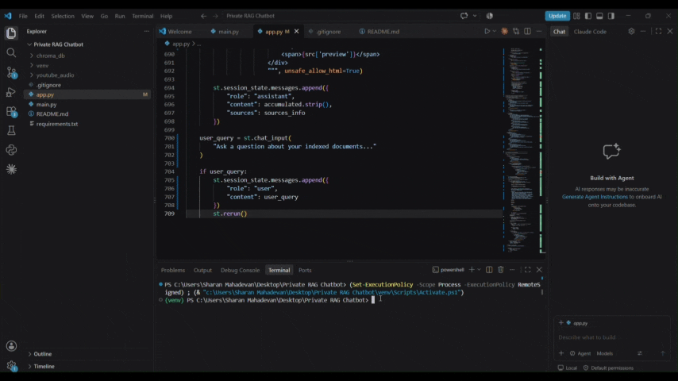

# 🔒 Private RAG Assistant

A fully local, privacy-first Retrieval-Augmented Generation (RAG) assistant for querying PDF documents using natural language — without sending document data to external cloud APIs.

## 🎯 What It Does

Upload one or more PDFs (research papers, notes, technical documentation, or study material) and ask natural-language questions about their content. The assistant retrieves relevant passages and generates answers grounded in the provided documents, with source citations to help you verify the information.

The application uses a locally running language model and local embeddings to provide a private document question-answering experience.

## 🤔 Why This Project

Researchers, students, and professionals often work with confidential documents that they may not want to upload to cloud-based AI services.

This project demonstrates how Retrieval-Augmented Generation (RAG) can be used to build a document assistant that processes PDFs, retrieves relevant information, and generates answers locally, helping keep sensitive document data under the user's control.

## 🏗️ Architecture

PDF Upload → Text Extraction → Text Chunking → Local Embeddings → Vector Database (ChromaDB) → Semantic Retrieval (Top-K Chunks) → LLM (Ollama / Llama 3.2) → Answer with Source Citations

## ⚙️ Tech Stack

| Component | Technology |
|---|---|
| Language Model | Ollama — Llama 3.2 (1B) |
| Embeddings | HuggingFace — all-MiniLM-L6-v2 |
| Vector Store | ChromaDB |
| Orchestration | LangChain |
| PDF Processing | PyPDFLoader |
| User Interface | Streamlit |
| Programming Language | Python |

## 🚀 How to Run Locally

### Prerequisites

- Python installed on your machine
- Ollama installed and running
- Sufficient system resources to run the selected language model

### Installation

1. Clone the repository:

   `git clone https://github.com/SharanMahadevan36/private-rag-assistant.git`

2. Navigate to the project directory:

   `cd private-rag-assistant`

3. Create a virtual environment:

   `python -m venv venv`

4. Activate the virtual environment.

   **Windows:**

   `venv\Scripts\activate`

   **macOS / Linux:**

   `source venv/bin/activate`

5. Install the dependencies:

   `pip install -r requirements.txt`

6. Download the language model:

   `ollama pull llama3.2:1b`

7. Start the application:

   `streamlit run app.py`

## 💡 Key Engineering Decisions

- **Local-first AI:** Uses Ollama for local language-model inference, reducing reliance on external AI APIs.
- **Lightweight language model:** Selected Llama 3.2 (1B) to make local inference more practical on resource-constrained hardware.
- **Source-grounded answers:** Retrieves relevant document passages to help ground responses in the provided content.
- **Source citations:** Provides source references to make answers easier to verify.
- **Multi-PDF support:** Allows users to upload and query multiple PDF documents using a shared vector store.
- **Semantic search:** Uses local embeddings to find relevant passages based on the meaning of a question.

## 📸 Demo

## 📄 License

MIT License
